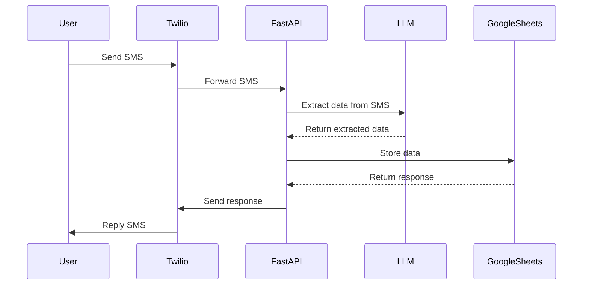

# Snooker Scores App

This project is a FastAPI application used to record match outcomes from our
friendly local snooker league.

- FastAPI app receives SMS messages from users as forwarded by Twilio
- LLM is used to extract data from the SMS messages (LangChain)
- Google Sheets is used to store the data and serve a view of the data to users
- hosted on Cloud Run (GCP)

## User flow



## Project Structure

Only listing the most important directories and files:

```plaintext
📂 resources/appScript/       # Backup of Google Apps Script contents from Google Sheets
📂 src/snooker_score_bot/
├── 📂 llm/                   # LLM interface and prompts
├── 📄 main.py                # FastAPI app: SMS webhook and HTTP API
├── 📄 sms.py                 # SMS -> recorded result and reply
├── 📄 verification.py        # Identifies players from a message; checks the LLM's answer
├── 📄 league.py              # All reads and writes of league data
├── 📄 storage.py             # Google Sheets backend, and an in-memory one for tests
├── 📄 cli.py                 # `snooker` command line tool
├── 📄 settings.py            # Per-league settings (prod, test, sixred)
├── 📄 twilio_client.py       # Twilio interface
└── 📄 models.py              # Pydantic models
📂 tests/
```

## Command line

`uv run snooker` administers the league sheets. Commands are grouped as `snooker <thing> <action>`; add `--help`
anywhere for details.

```plaintext
snooker [--league prod|test|sixred] [--json] ...

  round show                                current round, round dates, sheet link
  players list    [--group L7]
  matches list    [--round N | --all-rounds] [--group L7] [--status unplayed|completed]
  matches show    MATCH_ID                  with the breaks recorded with its result
  results record  MATCH_ID --score 0-2 [--winner Jani] [--break Jani:45]... [--date] [--log] [--overwrite]
  results clear   MATCH_ID [--with-breaks]
  breaks list     [--round N | --all-rounds] [--player NAME]
  breaks add      --player NAME --points 45 [--date] [--round]
  breaks remove   ROW --player NAME --points 45
  fixtures generate --round N               adds missing fixtures; safe to re-run
  fixtures reset  --round N --yes           test league only
  sms parse       "Jani - Mikko 2-0"        what the bot would record and reply (calls the LLM)
```

- The league defaults to `test`, or `$SNOOKER_LEAGUE`. Use `--league prod` for the real league.
- Commands never prompt. Writes accept `--dry-run` and print each changed row before and after.
- `MATCH_ID` can be a unique prefix of 6+ characters, as shown by `matches list`.
- `results record` takes the score in the match's player order (player1-player2). Pass `--winner` to have it
  refuse a score that makes someone else the winner.
- `--json` prints machine-readable output. Exit codes: 0 ok, 1 error, 2 invalid input, 3 not found,
  4 refused (already played, ambiguous, sheet changed meanwhile, not allowed for the league).
- Needs Google credentials, e.g. `GOOGLE_APPLICATION_CREDENTIALS=service-account.json`. `sms parse` also calls
  Vertex AI.

Correcting a wrongly recorded result:

```sh
snooker -l prod matches list --group L7
snooker -l prod results clear 2b53d651 --dry-run
snooker -l prod results clear 2b53d651
snooker -l prod results record d513c9f8 --score 0-2 --winner Jani --log "Jani - Mikko 2-0"
```

## Tests

```sh
uv run pytest
```

The tests run offline: the league uses an in-memory sheet, and the FastAPI app's services (sheet, Gemini, Twilio,
Pushover) are replaced through `app.dependency_overrides`. No credentials are needed.

## Usage

See [User Readme](USER-README.md) for more information.
